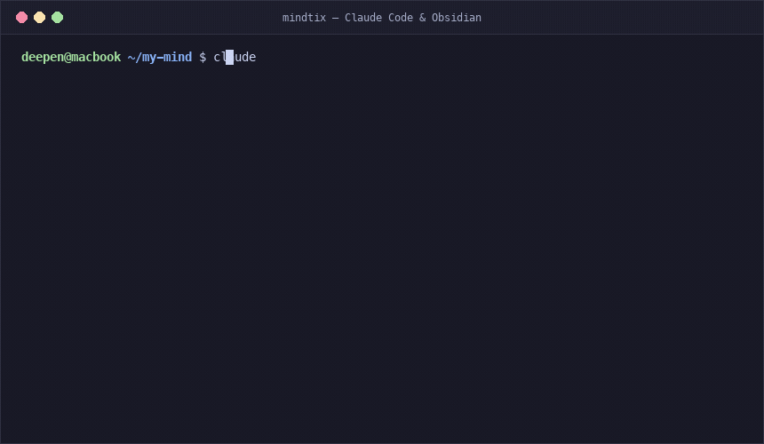

# mindtix

<p align="center">
  <a href="https://github.com/Cyrus-Gahatraj/mindtix/actions/workflows/test.yml"></a>
  <a href="https://github.com/Cyrus-Gahatraj/mindtix/stargazers"></a>
  <a href="https://obsidian.md"></a>
  <a href="https://opensource.org/licenses/MIT"></a>
</p>

<p align="center">
  <strong>A second brain that gets to know you, and helps you actually learn.</strong><br>
  <em>Mind + The Matrix.</em>
</p>

<p align="center">
  
</p>

Mindtix is a folder of plain markdown that an AI agent (Claude Code, Cursor, Codex, Gemini CLI) keeps for you.
You drop in your notes, writing and data exports. The AI builds pages about who you are and
what you know, tracks what you're learning, and quizzes you until it sticks. Everything is
local, readable in [Obsidian](https://obsidian.md), and 100% yours.

### Highlights
- 🧠 **Active Recall over Passive Hoarding:** Doesn't just save notes; quizzes and challenges you until concepts stick.
- 📇 **Spaced Repetition (FSRS):** Automatically schedules due reviews using modern FSRS algorithms (the same scheduler Anki uses).
- 🔄 **Anki Mobile Bridge:** Export cards directly into Anki with dedicated tags and decks for seamless mobile reviews.
- 💎 **100% Local Markdown:** No proprietary databases or vendor lock-in. Reads natively in Obsidian as an interconnected graph.
- 🛡️ **Zero Cloud / Privacy-First:** Your thoughts stay on your local disk. Built-in secret guards prevent credentials from leaking into notes.

## The layout

```
my-mind/
├── MIND.md        rules for the AI + short "who you are"
├── INDEX.md       one line per note; the AI reads this first
├── raw/           everything YOU put in. The AI reads it, never edits it
│   ├── notes/       your own notes
│   ├── imports/     data exports, transcripts, articles, PDFs
│   └── writing/     drafts and creative writing, verbatim
├── self/          who you are: profile, personality, people, timeline
├── knowledge/     one page per topic you understand, with recall cards
├── learning/      what you're learning now: maps, sessions, mistakes
├── projects/      one note per thing you make
├── hobbies/       one subfolder per hobby
├── extra/         anything else: school, work, health, ...
├── insight/       the AI's evidence-based read of you
├── logs/          chats with your brain (not committed)
└── private/       anything sensitive (not committed)
```

Details: [docs/structure.md](docs/structure.md).

## How learning works

You don't learn by reading. You learn by producing: recalling, explaining, predicting, doing.
Mindtix puts the AI in ten roles around that idea (interviewer, mapmaker, explainer, Socratic
questioner, examiner, checker, listener, diagnostician, challenger, clerk) and schedules
reviews with spaced repetition (FSRS, the scheduler Anki uses). It also learns *how you* learn:
every session, card and mistake is labelled, and `/mindtix reflect` works out which teaching
formats actually stick for you, how well your confidence matches your answers, and writes a
Teaching plan that `/mindtix learn` follows. See [docs/learning.md](docs/learning.md).

```
interview → map → try → explain only the stuck part → redo without help
        → quiz at your level → log mistakes → cards → review when due → diagnose patterns
```

## Install (Claude Code)

```
/plugin marketplace add Cyrus-Gahatraj/mindtix
/plugin install mindtix@mindtix
```

Then, in an empty folder (e.g. `~/mind`), run `/mindtix init`. It copies the empty brain
from [`skills/mindtix/template/`](skills/mindtix/template/) and asks you a few questions.
Mindtix remembers your brain location, so you can run `/mindtix capture` from any project
repository on your machine without switching directories. Notes automatically link back to
`[[projects/<repo-name>]]`.

**Codex, opencode, Gemini CLI, Cursor and other agents:**

```sh
git clone https://github.com/Cyrus-Gahatraj/mindtix && python3 mindtix/install.py
```

Then open your agent in an empty folder and say "set up mindtix". See
[docs/other-agents.md](docs/other-agents.md).

**Or from [skills.sh](https://skills.sh/cyrus-gahatraj/mindtix/mindtix)**, as one `mindtix` skill
that holds all the workflows (no hooks; the agent keeps those rules itself):

```sh
npx skills add Cyrus-Gahatraj/mindtix
```

## Workflows

### Core Workflows

| Command | What it does |
|---|---|
| `/mindtix init [folder]` | Creates a new brain and runs an initial setup interview |
| `/mindtix capture [text \| notes \| files]` | Fast capture of thoughts, notes, highlights, or loose files into the vault |
| `/mindtix learn <topic>` | Socratic inquiry, concept maps, mistake diagnostics, and scenario challenges (`challenge`) |
| `/mindtix recall [topic]` | Active spaced-repetition review of due cards using FSRS |
| `/mindtix today` | The daily 5-10 minutes: due cards, one learning step, one highlight |
| `/mindtix reflect [test]` | Evidence-based read of you (`insight/`), cognitive profile, and cross-domain connections |
| `/mindtix export [anki\|profile\|json\|bundle\|site]` | Export an Anki deck (`.apkg` ready), about-me for other AIs, JSON dump, or local web app |

### Utilities & Maintenance

| Command | What it does |
|---|---|
| `/mindtix import <path>` | Imports exports (WhatsApp, ChatGPT, Claude, Takeout, Obsidian, any folder or .zip) |
| `/mindtix tidy` | Health check: broken links, orphans, unlinked mentions, index drift, secrets, or scrub entities |
| `/mindtix review` | Weekly review: focus, learning progress, what to grow next |
| `/mindtix sort [files]` | Organizes and routes loose files into appropriate vault folders |

Mindtix is one skill, [`skills/mindtix/`](skills/mindtix/): `SKILL.md` picks the workflow, and
each workflow is a file in [`workflows/`](skills/mindtix/workflows/). One helper agent,
[`agents/reader.md`](agents/reader.md), reads big imports and large brains in parallel and
reports back facts only, so your chat stays light. It can't edit anything.

You can also just talk ("teach me SQL", "save this", "quiz me") and Claude picks the right workflow.
Ask your brain anything and it answers from your notes, citing each one, and offers to save a
good answer as a new page so the next question starts from it.

**Hooks** ([`hooks/`](hooks/)) enforce the rules that matter most, only inside a folder
that has `MIND.md`:
- **Secret guard:** blocks writing API keys, tokens, passwords or private keys into notes
- **raw/ guard:** blocks editing your own material in `raw/` (adding new files is fine)
- **Due cards:** at session start, tells Claude how many recall cards are due
- **Auto-commit:** after each reply, commits what changed if the brain is its own git repo,
  so every change can be undone. Skips (and warns) if a file looks like it holds a secret.
  Turn it off with `MINDTIX_AUTOCOMMIT=0`

## A first week

```
/mindtix init ~/mind                      # 5 questions, your brain exists
/mindtix import ~/Downloads/instagram.zip # who you are, people, timeline, interests
/mindtix capture notes                    # your notes in raw/notes/ become topic pages + cards
/mindtix learn sql                        # interview → map → build first → redo without help
/mindtix today                            # 5-10 minutes a day: due cards + one learning step
/mindtix reflect                          # the AI's read of you, with evidence
/mindtix review                           # once a week
```

Open the folder in [Obsidian](https://obsidian.md) to browse it as a linked graph.

## Privacy

- Everything stays in a local folder you own. Mindtix has no server.
- Imports are converted locally. Keys, passwords, phone and card numbers are masked first,
  and `raw/imports/`, `logs/`, `exports/` and `private/` are gitignored.
- What Claude reads is sent to Anthropic like any Claude Code session. Keep anything you
  never want sent in `private/` and don't ask the AI to open it.
- Changed your mind about someone you imported? `/mindtix forget <name>` removes them from
  every note, card and export, and tells you how to clear git history too.
- If you push your brain to GitHub, make the repo **private**.

## Requirements

- [Claude Code](https://claude.com/claude-code), or any agent with Agent Skills (Codex, opencode, Gemini CLI, Cursor)
- Python 3 (standard library only), for the hooks, importer and exporter
- Git (recommended: every change is a commit you can undo)

## Update or remove

```
/plugin marketplace update mindtix
/plugin uninstall mindtix@mindtix
```

Uninstalling never touches your brain folder; it's just markdown.

## Contributing

See [CONTRIBUTING.md](CONTRIBUTING.md) and [CHANGELOG.md](CHANGELOG.md).

## License

MIT
